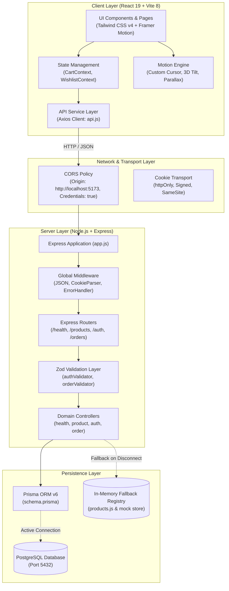
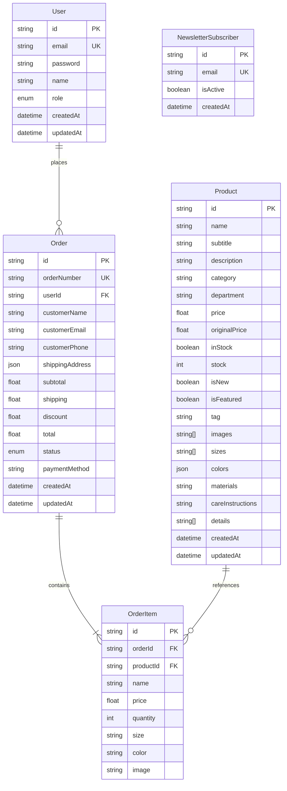
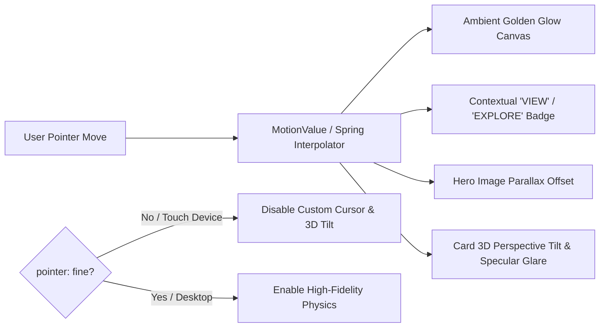

# AUREVA — System Architecture Specification
> **Brand**: AUREVA — *"Style without boundaries."*  
> **Document**: Full-Stack Architecture & Technical Blueprint  
> **Version**: 1.0.0  
> **Date**: October 2026  
> **Status**: Approved & Implemented  

---

## 1. Executive Summary & Design Principles

AUREVA is an architectural, neo-luxury fashion e-commerce platform. It is engineered with a **Decoupled Full-Stack Architecture** housed in a clean, unified repository. The system separates the high-performance motion-driven user interface from the secure, strongly typed backend services while maintaining seamless local development through workspace orchestration.

### Core Architectural Principles
1. **Separation of Concerns**: Total decoupling between the client presentation layer and backend domain services.
2. **Resilience by Default (Non-Blocking Boot)**: The server initializes without crashing even when PostgreSQL connection credentials are unconfigured or pending, gracefully falling back to validated in-memory catalog data while reporting diagnostic health.
3. **Zero-Re-Render Animation Physics**: High-frequency pointer tracking and ambient spotlights leverage direct Framer Motion `MotionValue`s outside React's render tree, preserving 60+ FPS on all devices.
4. **Strong Runtime Validation**: All incoming network payloads are strictly validated at the controller boundary using Zod schemas before touching business logic.
5. **Stateless Authentication with Secure Cookies**: JSON Web Tokens (JWT) signed with HMAC-SHA256 and transmitted via `httpOnly`, `SameSite=Lax/Strict` cookies.

---

## 2. High-Level System Architecture



---

## 3. Directory & Module Organization

```
e-com/
├── client/                                 # Frontend Client Application
│   ├── public/                             # Static public assets (favicons, SVG icons)
│   ├── src/
│   │   ├── assets/                         # Brand images & vector graphics
│   │   ├── components/                     # Reusable React components
│   │   │   ├── cart/                       # Sliding shopping bag drawer
│   │   │   ├── common/                     # Newsletter form, size chart modal
│   │   │   ├── layout/                     # Header, Footer, Layout wrapper, ScrollToTop
│   │   │   ├── motion/                     # Spotlight cursor, TiltCard, TextReveal, PageTransition
│   │   │   ├── product/                    # ProductCard, ProductQuickViewModal
│   │   │   ├── ui/                         # Buttons, MagneticButton wrapper
│   │   │   └── wishlist/                   # Wishlist side-drawer
│   │   ├── context/                        # React Context providers (CartContext, WishlistContext)
│   │   ├── data/                           # Verified static products catalog & collections
│   │   ├── hooks/                          # Custom hooks (useLocalStorage)
│   │   ├── layouts/                        # High-level layout exports
│   │   ├── pages/                          # Routed views (Home, Shop, ProductDetail, Cart, etc.)
│   │   ├── services/                       # Centralized Axios API instances (api.js, productService.js)
│   │   ├── utils/                          # Formatting & currency utilities
│   │   ├── App.jsx                         # React Router route hierarchy
│   │   ├── index.css                       # Design tokens, typography, custom scrollbars
│   │   └── main.jsx                        # React root mount
│   ├── .env.example                        # Client environment template
│   ├── .env                                # Local client environment variables (git-ignored)
│   ├── package.json                        # Frontend dependencies & Vite scripts
│   └── vite.config.js                      # Vite bundler configuration
│
├── server/                                 # Backend REST API Application
│   ├── prisma/
│   │   └── schema.prisma                   # PostgreSQL database schema & models
│   ├── src/
│   │   ├── config/
│   │   │   ├── env.js                      # Centralized environment loader & defaults
│   │   │   └── db.js                       # PrismaClient initialization & health checker
│   │   ├── controllers/
│   │   │   ├── healthController.js         # GET /api/health implementation
│   │   │   ├── productController.js        # Catalog queries & filtering
│   │   │   ├── authController.js           # Register, login, logout, me (JWT + cookies)
│   │   │   └── orderController.js          # Order creation & retrieval
│   │   ├── data/
│   │   │   └── products.js                 # Fallback catalog & seed data
│   │   ├── middleware/
│   │   │   ├── authMiddleware.js           # JWT verification & session extraction
│   │   │   ├── errorHandler.js             # Global centralized error formatting
│   │   │   └── validate.js                 # Generic Zod validation wrapper
│   │   ├── routes/
│   │   │   ├── index.js                    # Master router mounting all sub-routes
│   │   │   ├── healthRoutes.js             # /api/health routes
│   │   │   ├── productRoutes.js            # /api/products routes
│   │   │   ├── authRoutes.js               # /api/auth routes
│   │   │   └── orderRoutes.js              # /api/orders routes
│   │   ├── utils/
│   │   │   └── response.js                 # Consistent JSON response envelopes
│   │   ├── validators/
│   │   │   ├── authValidator.js            # User registration & login schemas
│   │   │   └── orderValidator.js           # Order creation & item schemas
│   │   ├── app.js                          # Express setup, CORS, body parsers, routes
│   │   └── server.js                       # HTTP server listener & graceful shutdown
│   ├── .env.example                        # Backend environment template
│   ├── .env                                # Local backend environment variables (git-ignored)
│   └── package.json                        # Backend dependencies & Express scripts
│
├── .gitignore                              # Comprehensive rules for dependencies, envs & build artifacts
├── .env.example                            # Root environment overview
├── package.json                            # Root monorepo orchestrator (concurrently)
└── README.md                               # Project quickstart & operational manual
```

---

## 4. Database Architecture & Data Models

### Entity Relationship Diagram (ERD)



---

## 5. Security & Authentication Architecture

### 1. Password Security
- Passwords are never stored in plaintext.
- Hashed using **bcrypt** with a minimum salt work factor of 10 (`bcrypt.hash(password, 10)`).

### 2. Session Management & Cookies
- User sessions are authenticated using stateless **JWTs** containing `{ id, email, name, role }`.
- Tokens are signed with `JWT_SECRET` and set inside an **`httpOnly` cookie** (`aureva_token`):
  - `httpOnly: true` (prevents malicious JavaScript access via XSS)
  - `secure: process.env.NODE_ENV === 'production'` (HTTPS only in production)
  - `sameSite: 'lax'` (prevents cross-site request forgery while permitting top-level navigation)
  - `maxAge: 7 * 24 * 60 * 60 * 1000` (7 days expiration)

### 3. Cross-Origin Resource Sharing (CORS)
- Origin whitelist dynamically configured via `process.env.CLIENT_URL` (default: `http://localhost:5173`).
- `credentials: true` enabled to allow secure cookie transmission across origins.
- Restricts HTTP methods to `GET, POST, PUT, PATCH, DELETE, OPTIONS`.

---

## 6. API Contracts & Envelope Standards

All endpoints communicate via standard HTTP verbs and adhere to a unified JSON envelope.

### Success Envelope
```json
{
  "success": true,
  "message": "Human-readable confirmation message",
  "data": { ... }
}
```

### Error Envelope
```json
{
  "success": false,
  "error": {
    "message": "Human-readable failure summary",
    "code": "ERROR_IDENTIFIER",
    "details": [
      {
        "field": "customerEmail",
        "message": "Valid email address is required"
      }
    ]
  }
}
```

### Key Error Codes
| Code | HTTP Status | Meaning |
|---|---|---|
| `VALIDATION_ERROR` | 400 | Payload failed Zod schema checks |
| `INVALID_JSON` | 400 | Body parser encountered malformed JSON syntax |
| `UNAUTHORIZED` | 401 | Missing or invalid authentication token |
| `INVALID_CREDENTIALS` | 401 | Email or password mismatch |
| `ROUTE_NOT_FOUND` | 404 | Endpoint does not exist |
| `PRODUCT_NOT_FOUND` | 404 | Requested product ID is not in archive |
| `EMAIL_ALREADY_EXISTS`| 409 | Attempting to register an email already taken |
| `INTERNAL_ERROR` | 500 | Unhandled server exception |

---

## 7. Motion & Interaction Architecture

The frontend avoids basic template behavior by embedding motion into user behavior:



- **Touch Device Isolation**: Media query `(pointer: fine)` automatically disables the custom cursor and tilt physics on phones and tablets, leaving native touch scrolling 100% fluid.
- **Accessibility**: Listens to `prefers-reduced-motion` and respects OS-level accessibility constraints.
- **Micro-Interactions**: Magnetic CTAs pull gently toward the mouse cursor using spring damping (`damping: 18, stiffness: 180`).

---

## 8. Development & Build Lifecycle

### Orchestration Commands
Root `package.json` coordinates both workspaces using `concurrently`:

```bash
# 1. Full-Stack Development (starts backend on :5000 and frontend on :5173)
npm run dev

# 2. Frontend Only
npm run dev:client

# 3. Backend Only (with nodemon hot-reload)
npm run dev:server

# 4. Production Build (Vite client bundle)
npm run build

# 5. Database Schema Generation (Prisma)
npm run build:server

# 6. Database Migrations (PostgreSQL)
npm run prisma:migrate
```
